<div align="center">


# eIsland — A Dynamic Island for your Windows desktop

[](https://github.com/JNTMTMTM/eIsland/releases/latest)
[](#getting-started)
[](LICENSE)

[**Download**](https://github.com/JNTMTMTM/eIsland/releases/latest) · [Website](https://www.pyisland.com) · [Developer docs](https://eisland-dev.pyisland.com) · [Changelog](docs/CHANGE_LOG.md)

</div>

> [!NOTE]
> eIsland is open source under GPLv3 with additional terms. See [License](#license) before redistributing.

## One island, four states

<p align="center">
  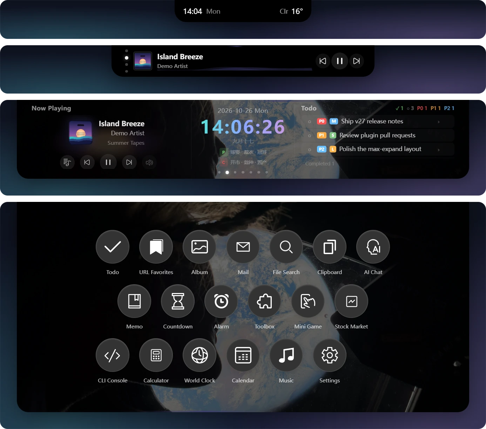
</p>

<p align="center"><b>Idle</b> → <b>Hover</b> → <b>Expanded</b> → <b>Max Expand</b><br/><sub>Rest the cursor on the island to peek, scroll the wheel to go deeper.</sub></p>

## Gallery

<table>
  <tr>
    <td width="50%">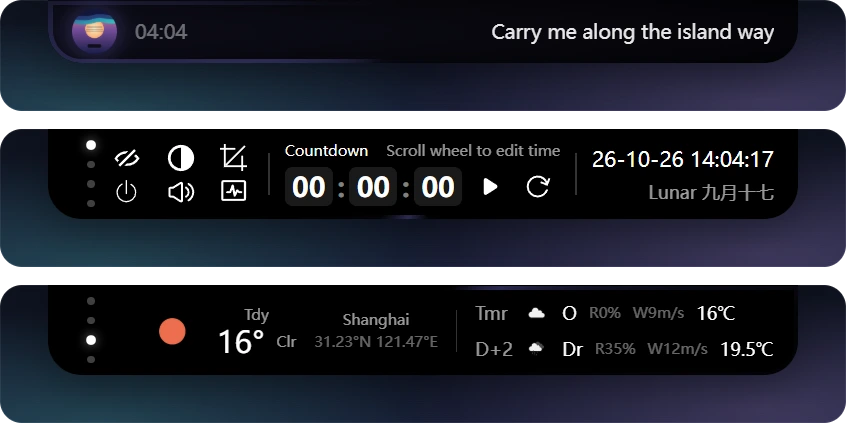<p align="center"><b>Lyrics & hover views</b></p></td>
    <td width="50%">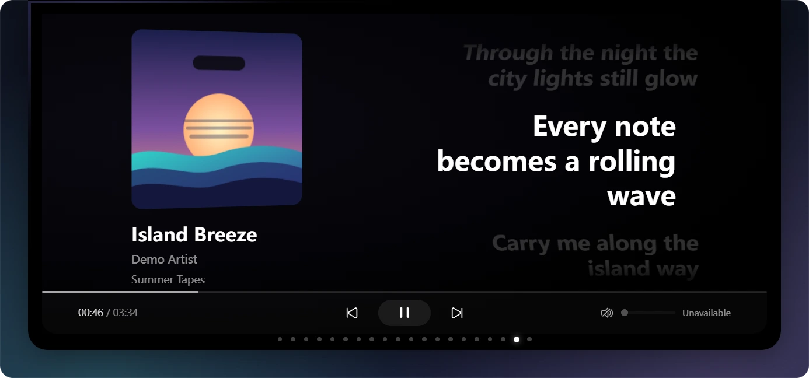<p align="center"><b>Music & lyrics</b></p></td>
  </tr>
  <tr>
    <td>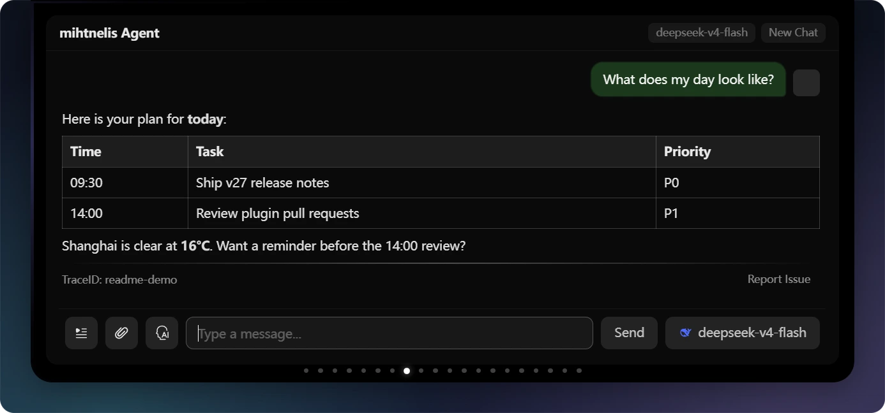<p align="center"><b>AI agent</b></p></td>
    <td>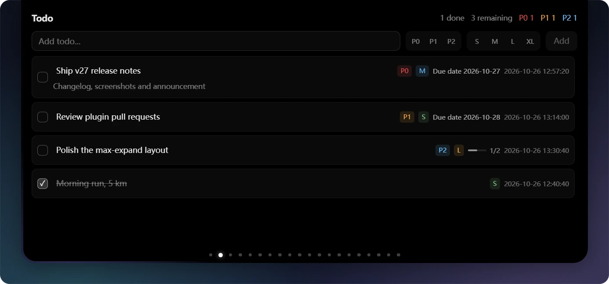<p align="center"><b>Todo</b></p></td>
  </tr>
  <tr>
    <td>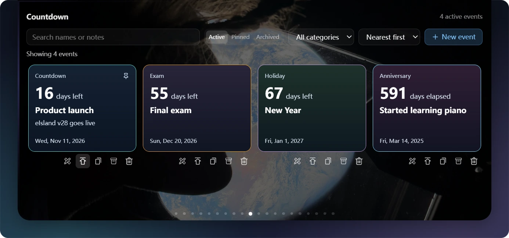<p align="center"><b>Countdown & wallpapers</b></p></td>
    <td>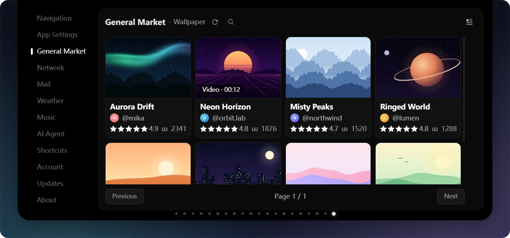<p align="center"><b>Wallpaper market</b></p></td>
  </tr>
  <tr>
    <td>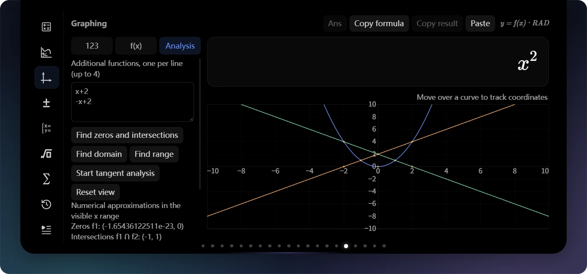<p align="center"><b>Graphing calculator</b></p></td>
    <td>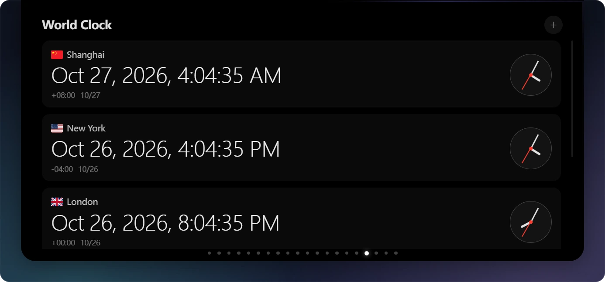<p align="center"><b>World clock</b></p></td>
  </tr>
  <tr>
    <td>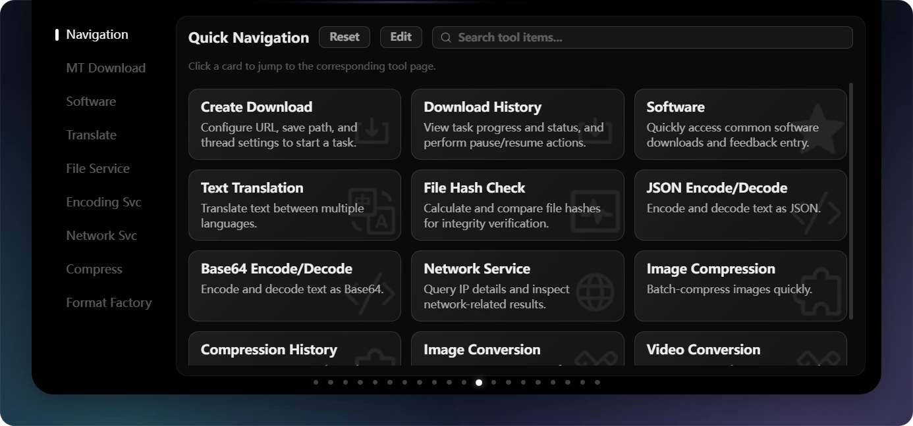<p align="center"><b>Toolbox</b></p></td>
    <td>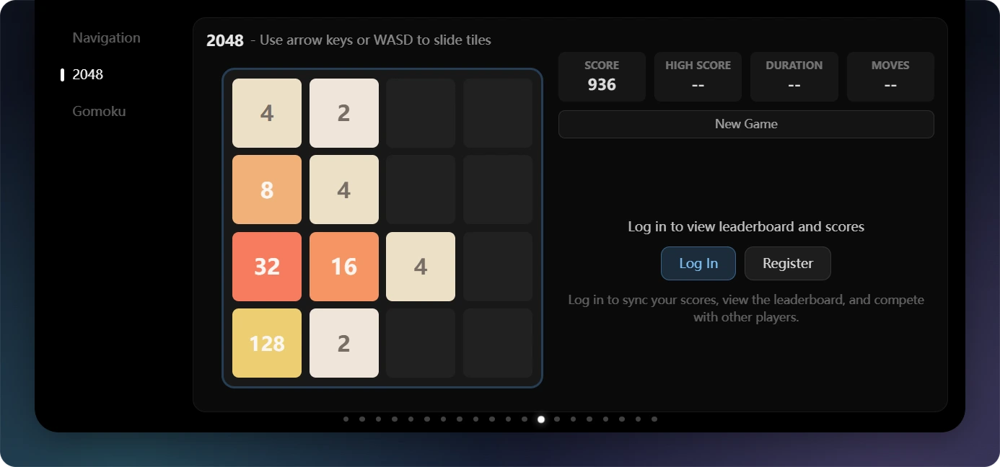<p align="center"><b>Mini games</b></p></td>
  </tr>
  <tr>
    <td>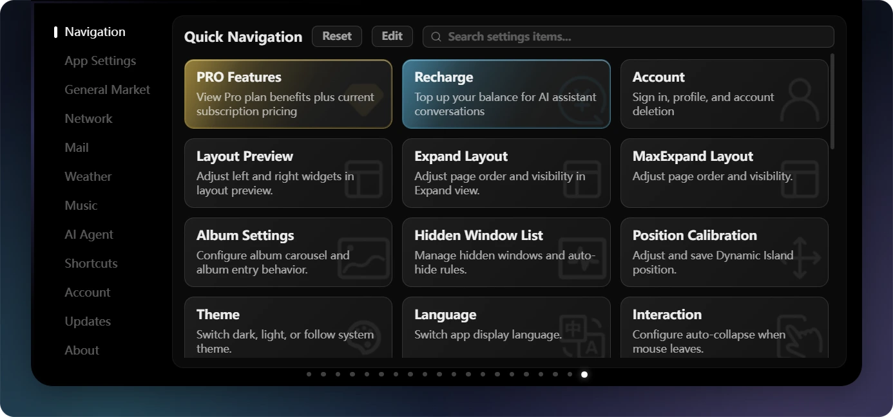<p align="center"><b>Settings</b></p></td>
    <td>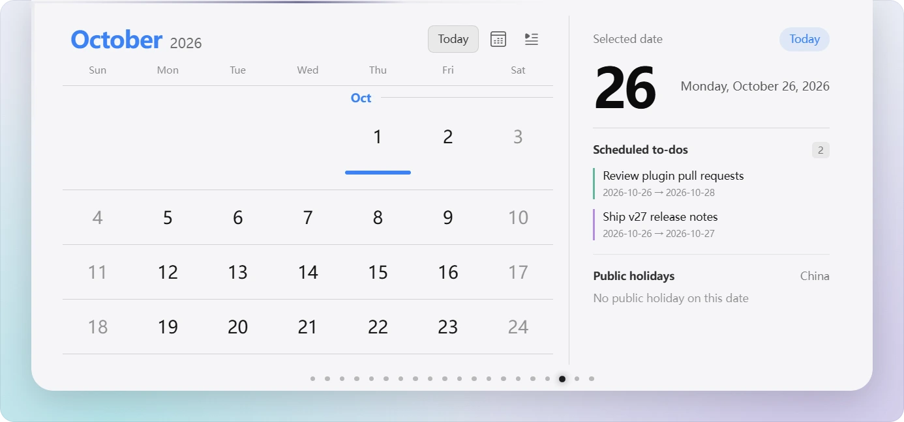<p align="center"><b>Light theme</b></p></td>
  </tr>
  <tr>
    <td colspan="2">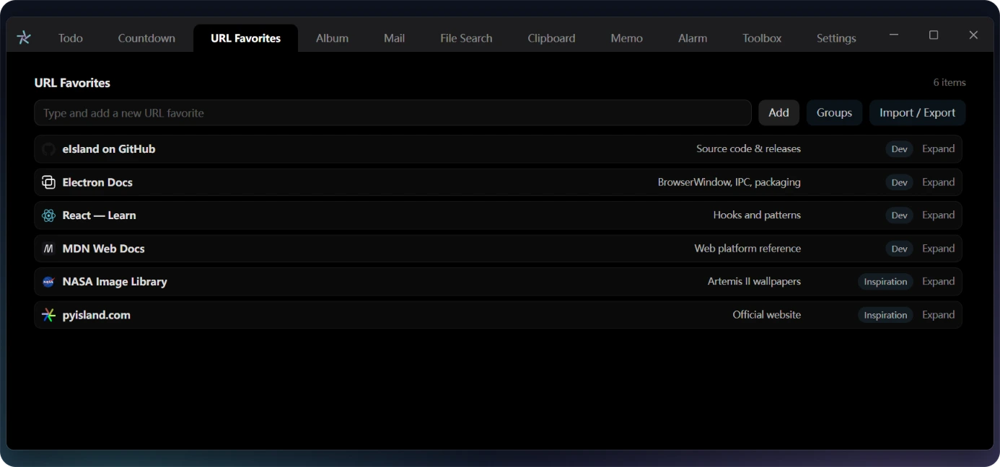<p align="center"><b>Standalone window</b></p></td>
  </tr>
</table>

## Getting started

Grab the latest `eIsland-<version>-Setup.exe` from [Releases](https://github.com/JNTMTMTM/eIsland/releases/latest) and run it. eIsland runs on Windows 10 22H2 or later (x64).

### Build from source

Requirements: Node.js `24.22.1` (see [`.nvmrc`](.nvmrc)), the .NET 10 SDK and the Visual Studio C++ build tools for the native plugins.

```sh
git clone https://github.com/JNTMTMTM/eIsland.git
cd eIsland
npm ci
npm run dev       # start with hot reload
npm run package   # build the NSIS installer into dist/
```

`npm run check` runs lint, type checks and tests. The [developer docs](https://eisland-dev.pyisland.com) cover the architecture, IPC APIs and plugins.

### Built with

[](https://www.electronjs.org/)
[](https://react.dev/)
[](https://www.typescriptlang.org/)
[](https://vite.dev/)
[](https://github.com/pmndrs/zustand)
[](https://tailwindcss.com/)
[](https://www.i18next.com/)
[](https://vitest.dev/)
[](https://playwright.dev/)

## Community

Bug reports and feature requests are welcome in [Issues](https://github.com/JNTMTMTM/eIsland/issues). Please follow the [Code of Conduct](.github/CODE_OF_CONDUCT.md).

## Credits

Icons come from [iconfont](https://www.iconfont.cn/). The built-in wallpapers are Artemis II mission photos from [NASA](https://www.nasa.gov/):

| Wallpaper | File | Capture device | Source |
|-----------|------|----------------|--------|
| Spaceship Earth | `art002e008487-orig.jpg` | iPhone 17 Pro Max | [images.nasa.gov](https://images.nasa.gov/details/art002e008487) |
| A Crescent Earth | `art002e004441-orig.jpg` | NIKON Z9 35mm f/2 | [images.nasa.gov](https://images.nasa.gov/details/art002e004441) |
| Thinking of You, Earth | `art002e008486-orig.jpg` | iPhone 17 Pro Max | [images.nasa.gov](https://images.nasa.gov/details/art002e008486) |

NASA images are used under NASA's image usage policy and do not imply NASA endorsement of this project. More Artemis II images: [images.nasa.gov](https://images.nasa.gov/) · [Artemis II mobile wallpapers](https://www.nasa.gov/artemis-ii-mobile-wallpapers/).

The music, todos, chat and wallpaper market listings shown in the screenshots are demo data.

## Legal

- [Terms of Service](docs/LEGAL/TERMS_OF_SERVICE.md)
- [Privacy Policy](docs/LEGAL/PRIVACY_POLICY.md)
- [Billing & Refund Policy](docs/LEGAL/BILLING_REFUND_POLICY.md)

## License

This project is released under **GNU General Public License v3.0 (GPLv3)** or later (`GPL-3.0-or-later`).

Under GPLv3 Section 7(b), limited additional terms apply: the following author attributions must be retained in all copies, modified versions, and any Appropriate Legal Notices displayed by the program:

- Copyright (C) 2026-present JNTMTMTM (https://github.com/JNTMTMTM)
- Copyright (C) 2026-present pyisland.com (https://pyisland.com)

For full terms (including the standard GPLv3 text and additional clauses), see the [`LICENSE`](LICENSE) file in the repository root.
